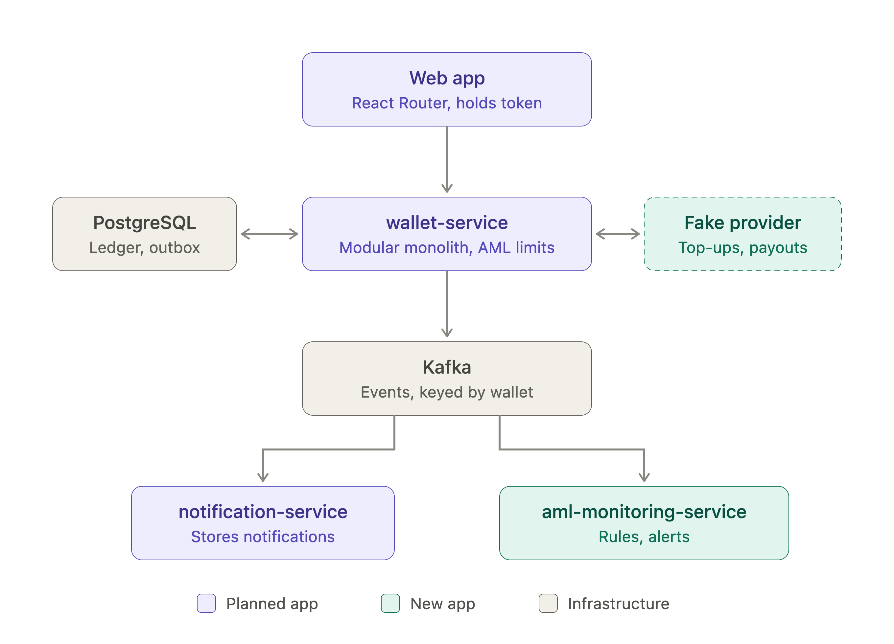

# p2p-payments

A PayPal-style peer-to-peer payments backend: users, wallets, top-ups, transfers, payouts and simulated AML checks.
Built as a learning project. Payments are simulated; no real money is involved.

## Architecture

## Status
- [ ] M0 · Project setup
- [ ] M1 · Core money movement (ledger, transactions)
- [ ] M2 · Idempotency and concurrency
- [ ] M3 · Kafka and the transactional outbox
- [ ] M4 · Authentication (Spring Security, JWT)
- [ ] M5 · Frontend
- [ ] M6 · Docker and Kubernetes
- [ ] M7 · Azure deployment

## Tech stack
Java 25 · Spring Boot 4 · Maven · PostgreSQL 18 · Testcontainers · GitHub Actions

## Running locally
Prerequisites: JDK 25, Docker. You don't need to install Maven; the wrapper (`mvnw`) is included.

    docker compose -f deploy/docker-compose.yaml up -d
    cd wallet-service
    ./mvnw spring-boot:run
    curl localhost:8080/actuator/health   # → "status":"UP"

Stop the database with `docker compose -f deploy/docker-compose.yaml down` (add `-v` to also delete its data).

## Running tests
Docker must be running: the tests start their own PostgreSQL with Testcontainers, so the Compose database isn't needed.

    cd wallet-service && ./mvnw verify

## Project structure
    wallet-service/       Spring Boot app, owns the database
      docs/               Requirements
    deploy/               Docker Compose (Kubernetes manifests later)
    docs/                 Architecture diagram, design decisions
    .github/workflows/    CI pipeline

## Design decisions
See [docs/decisions.md](docs/decisions.md).

## Requirements
See [wallet-service/docs/requirements.md](wallet-service/docs/requirements.md).
